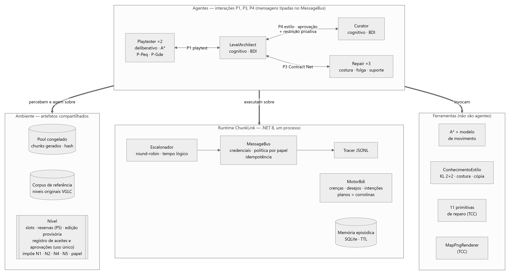
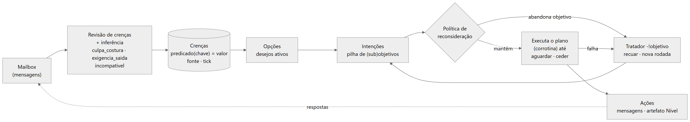
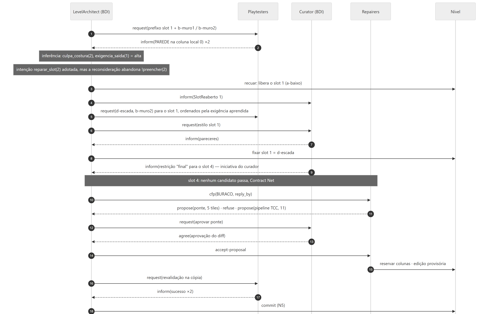

# ChunkLink — arquitetura, runtime e agentes cognitivos (DSM2, atualizado na DSM3)

Este documento justifica a arquitetura e o *runtime*, especifica as arquiteturas cognitivas do
arquiteto e do curador (principal ponto do parecer da DSM1), descreve a autonomia efetiva de cada
agente e o tratamento de conflitos, e liga requisitos do DSM1 a código e testes.

**Mudanças da DSM3**, em resposta ao parecer da DSM2:

- comunicação autenticada por credencial, com política por papel e idempotência;
- autorizações registradas e impostas pelo artefato Nível;
- modelo de movimento validado contra os níveis originais;
- memória persistente;
- reenvio de pedidos sem resposta.

Os protocolos estão especificados em [`PROTOCOLOS.md`](PROTOCOLOS.md); as evidências, em
[`EVIDENCIAS_DSM3.md`](EVIDENCIAS_DSM3.md).

## 1. Visão geral



Fonte editável: [`diagramas/arquitetura.mmd`](diagramas/arquitetura.mmd) (Mermaid; versão vetorial em
[`arquitetura.svg`](diagramas/arquitetura.svg)).

O sistema tem quatro camadas.

| Camada | Conteúdo | Onde |
|---|---|---|
| Agentes | LevelArchitect e Curator (cognitivos, BDI), 2 Playtesters (deliberativos, A*), 3 Repairers (Contract Net) | `src/ChunkLink.Core/Agentes/` |
| Ambiente | pool congelado de chunks, corpus de referência (níveis originais do VGLC) e o artefato **Nível** | `src/ChunkLink.Core/Ambiente/` |
| Runtime | escalonador determinístico, MessageBus com credenciais e política por papel, interpretador BDI, tracer JSONL, memória episódica (SQLite) | `src/ChunkLink.Core/{Runtime,Comunicacao,Bdi,Memoria}/` |
| Ferramentas | A* e modelo de movimento, conhecimento de estilo, 11 primitivas de reparo e renderizador do TCC | `Movimento/`, `Estilo/`, código do TCC |

## 2. Justificativa da arquitetura

**Quem é agente e quem não é.** Uma entidade é agente quando mantém estado próprio, decide
localmente e participa de protocolos (DSM1, Seção 4). Por isso:

- **LevelArchitect** é agente: mantém crenças sobre o nível e sobre a compatibilidade entre chunks,
  adota e abandona intenções e decide quando montar, reparar ou recuar.
- **Curator** é agente: tem objetivos próprios (parecer original, preservar o conteúdo gerado), crenças
  sobre o nível e o orçamento, iniciativa (restrições proativas) e poder de veto. O arquiteto não
  consegue contorná-lo, pois o artefato Nível recusa *commit* sem a aprovação dele (N5).
- **Playtesters** são agentes deliberativos simples: cada perfil tem seu modelo de movimento
  (informação privada), executa a própria busca e classifica a falha.
- **Repairers** são agentes reativo-deliberativos: decidem, pelo próprio conhecimento, se propõem ou
  recusam, calculam o custo do reparo e só agem depois de vencer o Contract Net.
- **Não são agentes**:
  - o gerador do TCC, o A*, o conhecimento de estilo, as primitivas de reparo e o renderizador, que
    são ferramentas sem objetivos nem iniciativa;
  - o MessageBus e o tracer, que são infraestrutura;
  - o **Nível**, que é um *artefato* do ambiente: guarda slots, reservas e edições provisórias e
    impõe as normas N3 e N5 no ponto de efeito.

**Reuso do TCC sem cópia.** `ChunkLink.Core.csproj` compila por *link* os arquivos do *dataloader* e da
avaliação do TCC: `TileMap`, `VglcLevelParser`, as 11 primitivas de `ChunkStructureRepair`,
`FailureModeAnalyzer` e `MapPngRenderer`. Fica de fora apenas `TileMapTensorConverter`, o único que
depende de TorchSharp. O gerador CFM roda separadamente, uma única vez, e sua saída é congelada com
`chunklink importar-pool`. Isso mantém o SMA independente de GPU e garante reprodutibilidade
(o gerador do TCC não expõe semente).

## 3. Justificativa do runtime

Critérios do livro-texto (§4.6): semântica necessária, testabilidade *offline*, reuso, custo e
maturidade.

| Opção | A favor | Contra, neste projeto | Decisão |
|---|---|---|---|
| **Runtime próprio em C#/.NET 8** | reuso direto do código do TCC (C#); determinismo total (um processo, tempo lógico); BDI explícito e rastreável; testes rápidos com xUnit; custo zero | não é distribuído; o interpretador BDI é mínimo (não implementa toda a semântica do AgentSpeak) | **escolhido** |
| Jason / JaCaMo | semântica BDI completa e declarativa | exigiria uma ponte Java↔C# para as primitivas, o renderizador e o A*; testes ponta a ponta mais lentos | descartado agora; plano declarativo mantido compatível |
| JADE | ACL FIPA, distribuição, diretório de serviços | BDI não nativo; distribuição não é requisito; ponte Java↔C# | descartado |
| SPADE | agentes assíncronos em Python | depende de servidor XMPP; reimplementaria o TCC em Python | descartado |
| Mesa | simulação baseada em agentes | foco em dinâmica de populações, não em protocolos e BDI | descartado |
| SDKs de agentes com LLM | orquestração e ferramentas | o problema não exige linguagem natural; acrescentaria custo e variabilidade | descartado (sem LLM no núcleo) |

O escalonador executa, a cada *tick*, um ciclo de cada agente numa ordem fixa: arquiteto, curador,
jogadores, reparadores. Cada ciclo percebe a caixa postal, revisa crenças, delibera e age. Prazos
(`reply_by`, timeouts) usam tempo lógico, então a mesma configuração produz o mesmo *trace*
(teste `RNF01_ExecucaoReproduzivel`).

## 4. Arquiteturas cognitivas

### 4.1 O interpretador BDI (`Bdi/MotorBdi.cs`)



O interpretador segue o estilo AgentSpeak:

- **Crenças**: proposições `predicado(chave) = valor`, cada uma com fonte (percepção, mensagem de X,
  inferência, deliberação, ação) e *tick*. Toda revisão gera `crenca+` ou `crenca-` no *trace*.
- **Desejos**: estados desejáveis com prioridade e condição de ativação sobre as crenças. Um desejo
  ativo sem intenção vira opção.
- **Intenções**: compromisso com um desejo, realizado por uma pilha de (sub)objetivos.
- **Planos**: `gatilho : contexto ← corpo`. O gatilho é `+!objetivo` para realização ou `-!objetivo`
  para tratamento de falha; o contexto é testado sobre as crenças. O corpo é uma **corrotina** que
  devolve passos ao interpretador: `Aguardar` (condição sobre crenças, com prazo), `SubObjetivo`,
  `Falhar` e `Ceder` (ponto de deliberação). Blocos `finally` encerram protocolos quando uma intenção
  é abandonada.
- **Falha**: se um plano falha, o interpretador procura um tratador `-!objetivo` aplicável; se não
  houver, a falha sobe para o objetivo pai.
- **Reconsideração**: a cada ciclo, uma política do agente examina cada intenção e pode abandonar um
  objetivo, com motivo registrado. O abandono aciona os tratadores daquele objetivo.

### 4.2 LevelArchitect (`Agentes/LevelArchitectAgent.cs`)

| Elemento | Conteúdo |
|---|---|
| **Crenças percebidas** | `teste(rodada\|chunk\|perfil)`, com o resultado de cada jogador; `parecer(conversa)`; `decisao(conversa)` (aprovação ou recusa do curador); `resposta_cn(conversa\|reparador)`; `edicao(conversa)`; `restricao(k)` (vinda do curador); `orcamento(nivel)` |
| **Crenças inferidas** | `falha_costura(k\|chunk)`: um candidato falhou até 2 colunas depois da fronteira. `culpa_costura(k)`: ≥ 2 candidatos distintos falharam na costura, logo a saída do slot k−1 é a causa provável. `exigencia_saida(k−1)=alta`: se a falha foi PAREDE, o slot k−1 precisa terminar alto. `incompativel(a\|b)`: o par não serve na ordem a→b (memória episódica). `culpado(k\|chunk)`: chunk retirado num recuo |
| **Desejo** | `montar_nivel_jogavel` (prioridade 10), ativo até `nivel_concluido` ou `nivel_falhou` |
| **Planos** | `montar_slot_a_slot` (`+!montar_nivel`); `playtest_individual` (`+!ranquear_pool`); `testar_candidatos` (`+!preencher(k)`, contexto: há candidatos); `contract_net_de_reparo` (`+!reparar_slot`, contexto: orçamento > 0); `liberar_slot_anterior` (`+!recuar`); `playtest_do_nivel_completo` (`+!validar_nivel`) |
| **Tratadores** | `-!preencher(k)`, em ordem: `recuar_por_culpa_da_costura` (contexto `culpa_costura(k)`), `tentar_outros_candidatos` (contexto: ainda há candidatos), `recuar_por_esgotamento`; `-!montar_nivel` → `registrar_falha_do_nivel` |
| **Reconsideração** | (a) com `reparar_slot(k)` no topo, se surgir `culpa_costura(k)`, abandona `preencher(k)`: reparar o candidato trataria o sintoma, não a causa. (b) se o curador informa orçamento esgotado, abandona `reparar_slot` |
| **Uso do conhecimento aprendido** | a *shortlist* exclui pares `incompativel`, ordena por `exigencia_saida` e pelas `restricao` do curador; na escolha, prefere candidatos que atendem à exigência aprendida |

Trecho real do cenário controlado (`exemplos/depuracao/narrativa.txt`):

```text
t=5  arquiteto  + crença culpa_costura(2) = 2 candidatos diferentes falham nas primeiras colunas do slot 2;
                  a saída do slot 1 é a causa provável  [fonte: inferência]
t=5  arquiteto  + crença exigencia_saida(1) = alta  [fonte: inferência]
t=6  arquiteto  ⟳ reconsideracao: abandonar !preencher — reparar o candidato trataria o sintoma, não a causa
t=6  arquiteto  • nivel.recuar: slot 1 reaberto, a-baixo removido
t=8  arquiteto  ✓ nivel.fixar: slot 1 = d-escada  (a escada atende à exigência aprendida)
```

### 4.3 Curator (`Agentes/CuratorAgent.cs`)

| Elemento | Conteúdo |
|---|---|
| **Conhecimento** | `ConhecimentoEstilo`, calculado sobre os níveis originais do bioma: média e desvio de densidade, chão contínuo, estruturas, inimigos e blocos por posição (início, meio, fim); distribuição de padrões 2×2; percentil 95 dos saltos de altura do chão (limiar de costura); janelas originais para detectar cópia |
| **Crenças** | `slot(k)`, `custo(k)`, `densidade(k)` (percebidos do nível e das mensagens); `orcamento(nivel)`; `pedido(id)`; `vetado(chunk)=N2\|N4`; `impasse(k)` (recusas por estilo); `limiar(k)` (após concessão); `estilo_relaxado(k)`; `restricao_emitida(k)` |
| **Desejos** | `atender_pedidos` (prioridade 10, reativo) e `parecer_original` (prioridade 5, **proativo**: ativo quando a próxima posição exige uma restrição, como o slot final ou dois trechos seguidos densos demais) |
| **Planos** | `avaliar_estilo`, `decidir_aprovacao`, `emitir_restricao` |
| **Reconsideração** | após cada recusa por estilo no slot k, **concede** (`limiar(k) = 1,5 · (1 + 0,25·n)`); após 2 impasses, **suspende o desejo** `parecer_original` naquele slot. As normas N1, N2 e N4 nunca são relaxadas |

### 4.4 Agentes não cognitivos

- **Playtester**: busca A* com estados "em pé" e saltos parametrizados por perfil (corpo c, altura h,
  alcance d), mais um *cache* por trecho. Na DSM3, o modelo de movimento ganhou:
  - quebra de tijolos por baixo pelo Mario grande;
  - pisão em inimigos, que serve de quique ou mata o inimigo;
  - impulso horizontal na queda;
  - alcance calibrado em d = 5.

  Validado contra os níveis originais: 21/30 combinações completáveis, contra 8/30 na DSM2
  (`EVIDENCIAS_DSM3.md` §1).
- **Repairer**: cada um tem especialidade e estratégia locais.
  - *costura*: ponte sobre buraco ou rebaixamento de parede;
  - *folga*: abre altura livre para o Mario grande;
  - *suporte*: aplica a pipeline completa do TCC e atua como generalista, sem saber a causa da falha.

  Cada conversa segue a máquina de estados do Contract Net (`ConversaContractNet`); uma mensagem
  fora de ordem gera `ViolacaoProtocolo`.

## 5. Autonomia efetiva diante da coordenação

O arquiteto coordena a montagem, mas **não comanda** os demais:

| Agente | Decide sozinho | O arquiteto não pode |
|---|---|---|
| Curator | aceitar, recusar ou vetar candidatos e diffs; quando conceder; quando e o que restringir | efetivar uma edição sem a `Aprovacao` do curador para aquele diff (o artefato Nível recusa) |
| Repairer | propor ou recusar; como reparar; quanto custa | escolher a estratégia de reparo ou obrigar um reparador a propor |
| Playtester | o caminho e a classificação da falha (BURACO, PAREDE, TETO, INIMIGO…) | alterar o resultado de jogabilidade |
| LevelArchitect | ordem de teste, quando reparar, quando recuar, o que aprender | ignorar normas, prazos ou o veto do curador |

## 6. Conflitos entre objetivos

Ordem de prioridade explícita: **normas (N1–N5) > jogabilidade dos perfis-alvo > estilo > fidelidade
(poucas edições)**.

| Conflito | Mecanismo | Onde aparece |
|---|---|---|
| Jogabilidade × estilo | o curador recusa com motivo; o arquiteto tenta outra rodada; após impasses, o curador concede e depois suspende o estilo naquele slot | treetop real (`exemplos/montagem-treetop/trace.jsonl`); teste `Curador_ConcedeESuspendeDesejoDeEstiloAposImpasses` |
| Jogabilidade × fidelidade | reparo só por Contract Net; propostas em ordem de custo; cada uma precisa da aprovação do curador (e_max, orçamento, estilo do resultado) | cenário controlado, slot 4 |
| Reparo inútil | edição provisória, revalidação e *rollback*; tenta a próxima proposta | teste `RF06_RevalidacaoFalhaFazRollbackETentaAProximaProposta`: a proposta mais barata é aprovada, falha na revalidação e é revertida; a seguinte é efetivada |
| Causa no slot anterior | inferência `culpa_costura` → reconsideração → recuo com `exigencia_saida` | cenário controlado, slots 1 e 2 |
| Concorrência entre reparadores | reserva de colunas com intervalo meio-aberto | teste `RS01_ReservaSobrepostaRecusada_AdjacenteAceita` |

## 7. Interações implementadas

A especificação completa dos protocolos (mensagens, máquinas de estado, prazos, falhas e
alternativas) está em [`PROTOCOLOS.md`](PROTOCOLOS.md).



| Protocolo (DSM1) | Mensagens | Código |
|---|---|---|
| P1 Playtest | `request(PedidoPlaytest)` → `inform(RespostaPlaytest)` | `PlaytesterAgent`, `LevelArchitectAgent.Preencher` |
| P2 Preenchimento de slot | intenção `preencher(k)` e seus tratadores | `LevelArchitectAgent` |
| P3 Contract Net | `cfp` → `propose`/`refuse` → (reply_by) → `accept`/`reject` → `inform`/`failure` | `RepairAgent`, `ConversaContractNet`, `LevelArchitectAgent.RepararSlot` |
| P4 Estilo e aprovação | `request(PedidoEstilo)` → `inform(RespostaEstilo)`; `request(PedidoAprovacao)` → `agree(Aprovacao)`/`refuse(RecusaAprovacao)`; `inform(RestricaoCurador)` proativo | `CuratorAgent` |
| P5 Reserva | `Nivel.AbrirEdicao` reserva as colunas; `Commit`/`Rollback` liberam | `Nivel`, `TabelaReservas` |

## 8. Rastreabilidade: requisito → código → teste

| Requisito (DSM1) | Código | Teste |
|---|---|---|
| RF01 pool e referência | `PoolChunks`, `CorpusReferencia`, `Grade.DeAscii` | `RF01_Pool_RejeitaChunkInvalido`, `RF01_Pool_CongeladoDetectaAlteracaoPorHash` |
| RF02 jogadores A* | `BuscaAEstrela`, `SimuladorMovimento`, `PlaytesterAgent` | `RF02_*` (5 testes) |
| RF03 ranking | `LevelArchitectAgent.RanquearPool` | `RNF01_ExecucaoReproduzivel` |
| RF04, RF08 montagem e validação | `Preencher`, `ValidarNivel` | `RF04_RF08_CenarioControladoMontaNivelJogavelPorTodosOsPerfis` |
| RF05, RF06 Contract Net, aprovação, revalidação, commit | `RepararSlot`, `RepairAgent`, `Nivel.Commit` | `RF05_RF06_*`, `RF05_PropostaTardia…`, `RF06_RevalidacaoFalhaFazRollback…`, `RS03_CommitSemAprovacao…` |
| RF07 falha explícita | tratadores `-!preencher`, `-!montar_nivel` | `RF07_PoolInsuficienteTerminaComFalhaExplicita` |
| RF09 par cego | `Renderizacao.RenderizarParCego` | `RF09_ParCegoTemMesmaEscalaEGabaritoSeparado` |
| RF11 métricas de estilo | `ConhecimentoEstilo` | `RF11_EstiloDosOriginaisFicaDentroDaFaixaDeReferencia` |
| RNF01 reprodutibilidade | escalonador, tempo lógico, pool com *hash* | `RNF01_ExecucaoReproduzivel` |
| RNF03 observabilidade | `Tracer` (JSONL) | `RNF03_*` (2 testes) |
| RNF04 orçamento de busca | `PerfilJogador.OrcamentoNos` | `RNF04_OrcamentoDaBuscaEsgotadoViraInconclusivo` |
| RS01 reservas | `TabelaReservas` | `RS01_ReservaSobrepostaRecusada_AdjacenteAceita` |
| RS02 orçamento (N1) | `CuratorAgent.DecidirAprovacao` | `RF05_PropostaTardiaNaoEhConsideradaERS02_CuradorRecusaAcimaDoLimite` |
| RS03 fail closed (N5) | `Nivel.Commit` | `RS03_CommitSemAprovacaoValidaEhNegadoENaoAlteraNivel` |
| RS04 sem cópia (N4) | `ConhecimentoEstilo.MenorDistanciaAOriginais`, curador | `RS04_*` (2 testes) |
| Cognição (parecer da DSM1) | `MotorBdi`, políticas dos agentes | `Bdi_*`, `Arquiteto_*`, `Curador_*`, `Ablacao_SemCognicaoNaoHaInferenciaNemReconsideracao` |
| Segurança da comunicação (DSM3) | `Credencial`, `PoliticaPapeis`, `MessageBus` | `Seg_CredencialDeOutroBarramento…`, `Seg_PoliticaDePapeis…`, `Seg_ExecucaoNormalNaoViola…` |
| Autorização no ambiente (DSM3) | registro de aceites e aprovações em `Nivel` | `Seg_AprovacaoNaoPodeSerReutilizada`, `Seg_FixarExige…`, `Seg_NivelImpoeN1N2EN4…`, `RS03_*` |
| Robustez a falhas (DSM3) | `InjetorFalhas`, `Agente.Receber` (idempotência), reenvio no arquiteto | `Rob_MensagensDuplicadas…`, `Rob_PerdaDeMensagens…`, `Rob_ViolacaoDeProtocolo…` |
| Invariantes sob entradas aleatórias (DSM3) | sistema completo | `Prop_InvariantesValemEmPoolsEConfiguracoesAleatorios` (12 casos) |
| Fidelidade do movimento (DSM3) | `SimuladorMovimento` (quebra, pisão, impulso) | `Mov_*`; `chunklink validar-movimento` |
| Memória persistente (CP9) | `MemoriaEpisodica`, `LevelArchitectAgent.CarregarMemoria/Memorizar` | `Mem_*` |

RF10 (teste cego com humanos) e RS05 (privacidade) são procedimentos externos ao SMA, planejados em
[`PROTOCOLO_EXPERIMENTAL.md`](PROTOCOLO_EXPERIMENTAL.md).

## 9. Segurança e invariantes impostas pelo ambiente (DSM3)

- **Credenciais:** cada agente recebe, no registro, uma `Credencial` que só o barramento constrói. Ela
  identifica o agente nas mensagens (o remetente é carimbado) e nas operações sobre o Nível.
- **Política por papel:** um papel só pode enviar certos pares (performativa, conteúdo), e o
  conteúdo não pode falar em nome de outro agente (`PoliticaPapeis`).
- **Registro de autorizações no Nível:** o curador registra aceites (para fixar) e aprovações (para
  efetivar edições). Cada uma vale para uma conversa, um slot, um chunk e, no caso das aprovações,
  um diff, e é de uso único.
- **Normas no ponto de efeito:** `Fixar`, `AbrirEdicao` e `Commit` conferem o papel, a ordem dos
  slots, N1, N2 e N4, além da autorização. Se algo falha, nada muda.
- **Idempotência e reenvio:** mensagens repetidas são descartadas pelo `id`; pedidos sem resposta
  são reenviados até `Reenvios` vezes. Toda edição aberta de uma negociação é desfeita quando ela
  termina.
- **Ameaça considerada:** erro de coordenação e agente que usa mal o protocolo dentro do processo.
  Não protege contra código arbitrário com acesso direto à memória do processo.

## 10. Memória entre execuções (CP9)

O arquiteto grava, ao fim da execução, as incompatibilidades e os vetos que observou, indexados pelo
*hash* do chunk, em SQLite (`Memoria/MemoriaEpisodica.cs`). Na execução seguinte, eles entram como
crenças com fonte `memória`. O TTL é contado em execuções: um episódio que não é observado de novo
expira depois de `TtlMemoria` execuções.

## 11. Limitações registradas

1. **Modelo de movimento discreto**: são gabaritos de salto, não a física do NES. Não há plataformas
   móveis (o VGLC não as representa), deslizar agachado nem o pulo de corrida máximo. Por isso 9 de
   30 combinações nível original × perfil ainda não são completáveis (`EVIDENCIAS_DSM3.md` §1).
2. **Interpretador BDI mínimo**: não há eventos externos genéricos, intenções concorrentes do mesmo
   desejo, nem semântica AgentSpeak completa (unificação, anotações).
3. **Runtime de um processo**: não há concorrência física nem distribuição. A reserva de colunas
   foi testada isoladamente; no fluxo atual os reparos são sequenciais. Sob escassez de chunks, a
   norma de fidelidade (e_max) faz o curador recusar reparos grandes, e o sistema monta menos que o
   baseline central (`EVIDENCIAS_DSM3.md` §3.5).
4. **Estilo por características simples**: densidade, chão, estruturas, inimigos e blocos, mais a
   divergência KL de padrões 2×2. Isso não capta, por exemplo, ritmo nem agrupamento de blocos.
   **Os níveis montados ainda são facilmente distinguíveis dos originais** (ver
   `exemplos/montagem-*/teste-cego/`): o gerador produz muitos tijolos isolados e poucos buracos ou
   escadas.
5. **Parâmetros iniciais não calibrados**: perfis, limiares de estilo, orçamento e τ de cópia.
6. **Pool pequeno**: 30 chunks por bioma, de uma única geração. Os números de `comparar` vêm de uma
   execução por bioma e **não** sustentam conclusões estatísticas.
7. **Perfil iniciante e estatística**: P-Ini existe no código, mas não é usado. Os lotes de 10
   sementes da DSM3 não têm testes estatísticos; eles ficam para a DSM4.
