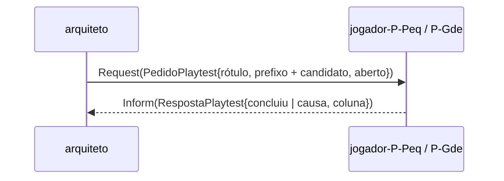
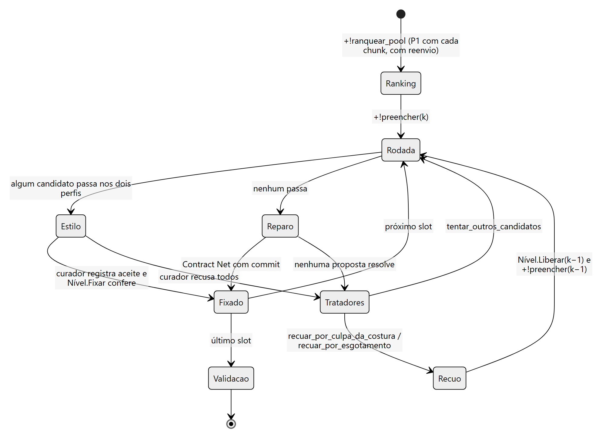
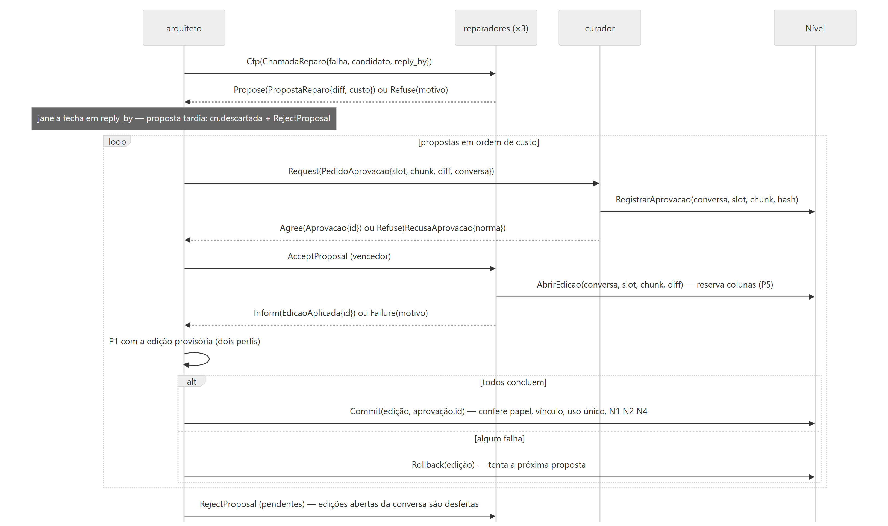

# Protocolos de interação do ChunkLink (DSM3)

Este documento especifica a comunicação entre os agentes: o formato das mensagens, a finalidade de
cada protocolo, quem participa, as mensagens trocadas e em que ordem, os prazos, e o que acontece
quando algo falha. Também descreve as garantias de segurança acrescentadas na DSM3 em resposta ao
parecer da DSM2.

Os nomes de código citados estão em `src/ChunkLink.Core/`.

## 1. Mensagens, papéis e transporte

### 1.1 Formato

Toda mensagem é `m = ⟨s, r, p, c, o, k⟩` mais um identificador e o instante de envio
(`Comunicacao/Mensagens.cs`, `Mensagem`):

| Campo | Significado | Exemplo |
|---|---|---|
| `s` (remetente) | **carimbado pelo barramento** a partir da credencial de quem envia | `arquiteto` |
| `r` (destinatário) | agente registrado | `curador` |
| `p` (performativa) | `Request`, `Inform`, `Cfp`, `Propose`, `Refuse`, `AcceptProposal`, `RejectProposal`, `Agree`, `Failure` | `Cfp` |
| `c` (conteúdo) | um tipo da ontologia `smb.level` (§1.4) | `ChamadaReparo` |
| `o` (ontologia) | `smb.level` | — |
| `k` (conversa) | identificador que agrupa as mensagens de uma interação | `reparo:4:1` |
| `id`, `tick` | identificador único (atribuído pelo barramento) e tempo lógico de envio | `271`, `16` |

### 1.2 Papéis e agentes

| Papel | Agentes | Tipo de agente |
|---|---|---|
| Arquiteto | `arquiteto` | cognitivo (BDI) |
| Curador | `curador` | cognitivo (BDI) |
| Jogador | `jogador-P-Peq`, `jogador-P-Gde` | deliberativo (busca A*) |
| Reparador | `reparador-costura`, `reparador-folga`, `reparador-suporte` | reativo-deliberativo |

### 1.3 Transporte e garantias

O `MessageBus` mantém uma caixa postal por agente e entrega em ordem de envio, em tempo lógico.
Na DSM3 ele passou a garantir:

1. **Remetente autenticado.** No registro, o barramento entrega ao agente uma `Credencial`, um objeto
   que só o barramento constrói. `Enviar` e `Retirar` exigem a credencial; uma credencial que não foi
   emitida por aquele barramento é recusada (`CredencialInvalida`). O remetente da mensagem é o dono
   da credencial: não existe parâmetro de texto para "de quem".
2. **Política por papel (CP10).** Cada papel só pode enviar certos pares (performativa, conteúdo),
   conforme a tabela abaixo; o resto gera `ViolacaoPolitica` e o evento `msg.rejeitada` no trace.
   Qualquer papel pode responder `Failure` com texto (pedido não entendido, erro de protocolo).
3. **Coerência entre conteúdo e remetente.** Uma `PropostaReparo` só pode ser enviada pelo reparador
   que ela nomeia; uma `Aprovacao`, só pelo curador que a emitiu.
4. **Idempotência.** Cada agente descarta uma mensagem com `id` já recebido e registra
   `msg.duplicada`. Assim, uma entrega repetida não tem efeito duplo.
5. **Injeção de falhas para teste.** `InjetorFalhas` duplica ou perde mensagens com probabilidades e
   semente fixas (`chunklink depurar --duplicar 0.3 --perder 0.05`).

| Papel | Pode enviar |
|---|---|
| Arquiteto | `Request(PedidoPlaytest)`, `Request(PedidoEstilo)`, `Request(PedidoAprovacao)`, `Inform(SlotFechado)`, `Inform(SlotReaberto)`, `Cfp(ChamadaReparo)`, `AcceptProposal`, `RejectProposal` |
| Curador | `Inform(RespostaEstilo)`, `Inform(RestricaoCurador)`, `Agree(Aprovacao)`, `Refuse(RecusaAprovacao)` |
| Jogador | `Inform(RespostaPlaytest)` |
| Reparador | `Propose(PropostaReparo)`, `Refuse(motivo)`, `Inform(EdicaoAplicada)` |
| Todos | `Failure(motivo)` |

### 1.4 Ontologia `smb.level`

| Conteúdo | Campos principais | Usado em |
|---|---|---|
| `PedidoPlaytest` | rótulo, trecho (grade de tiles), trecho aberto à direita? | P1 |
| `RespostaPlaytest` | rótulo, resultado (concluiu, coluna máxima, causa da falha, coluna da falha) | P1 |
| `PedidoEstilo` | slot, total de slots, candidatos, vizinho à esquerda | P4 |
| `RespostaEstilo` | pareceres (aceitável?, veto, justificativa, **id do aceite**), limiar usado, estilo relaxado? | P4 |
| `RestricaoCurador` | slot, tipo (`final`, `esparso`), motivo | P4 (proativo) |
| `ChamadaReparo` | falha (slot, chunk, causa, coluna local, alcance e altura do salto), candidato, prazo `reply_by` | P3 |
| `PropostaReparo` | reparador, diff (alterações de tiles e estratégia), tick de envio | P3 |
| `PedidoAprovacao` | slot, chunk, diff, resultado, **conversa da negociação** | P4/P3 |
| `Aprovacao` | **id**, emissor, conversa, slot, chunk, hash do diff | P4/P3 |
| `RecusaAprovacao` | motivo, norma violada, orçamento restante | P4/P3 |
| `EdicaoAplicada` | id da edição provisória | P3/P5 |
| `SlotFechado`, `SlotReaberto` | slot, chunk, tiles editados / motivo | P2 |

## 2. Autorização imposta pelo ambiente

O parecer da DSM2 apontou que a aprovação do curador era só "curador + hash do diff" e que fixar um
chunk dependia da disciplina do arquiteto. Na DSM3, **o artefato `Nivel` guarda um registro de
autorizações** e confere tudo no ponto de efeito (`Ambiente/Nivel.cs`):

| Operação | Quem pode | O Nível verifica antes de alterar qualquer estado |
|---|---|---|
| `RegistrarAceite` | Curador | credencial válida do papel Curador |
| `RegistrarAprovacao` | Curador | idem |
| `Fixar(slot, chunk, aceite)` | Arquiteto | aceite existe, não foi usado e vale para **este slot e este chunk**; ordem dos slots; N2 (sem repetição); N4 (distância a originais ≥ τ) |
| `AbrirEdicao` | Reparador | ordem dos slots; N2; reserva de colunas (N3) |
| `Commit(edição, aprovação)` | Arquiteto | aprovação existe, não foi usada e vale para **esta conversa, este slot, este chunk e este hash**; N1 (e_max por chunk e orçamento do nível); N2; N4 |
| `Rollback`, `Liberar` | Arquiteto | credencial válida do papel Arquiteto |

Se uma verificação falha, o Nível lança `ViolacaoNorma` com a norma (`N1`, `N2`, `N4`, `N5`,
`PAPEL`, `SEQ`) e **nada muda** (fail closed). Aceites e aprovações são de uso único.

Os testes `Seg_*` (`tests/ChunkLink.Tests/TestesRobustez.cs`) tentam, sem sucesso:

- forjar o remetente com uma credencial de outro barramento;
- enviar mensagens fora do papel;
- reutilizar uma aprovação;
- usar o aceite de outro slot ou de outro chunk;
- fixar um chunk repetido ou copiado;
- efetivar uma edição acima de e_max.

## 3. P1 — Playtest

**Finalidade:** saber se um trecho é jogável por um perfil e, se não for, onde e por quê.

**Participantes:** arquiteto (iniciador) e jogadores (respondedores).

- **Pré-condição:** o trecho tem 14 linhas e largura múltipla de 28.
- **Trecho aberto:** durante a montagem, o candidato vai à direita do prefixo já fixado, e o objetivo
  é chegar a até d − 1 colunas da borda. A costura com o próximo slot é testada no prefixo seguinte.
- **Prazo e reenvio:** o arquiteto espera até `PrazoResposta` ticks e então **reenvia só os pedidos
  sem resposta**, até `Reenvios` = 2 vezes (evento `reenvio`). O reenvio é seguro porque o jogador é
  idempotente: tem cache por trecho, e uma resposta repetida só reafirma a crença.
- **Falhas e alternativas:**

| Falha | Tratamento |
|---|---|
| resposta perdida ou atrasada | reenvio do pedido; se mesmo assim faltar resposta, o candidato conta como não aprovado (no ranking, vai para o fim) e os tratadores de `-!preencher` seguem: recuar por culpa da costura, nova rodada de candidatos ou recuar por esgotamento |
| busca sem resposta dentro do orçamento de nós | causa `Inconclusivo` (não conta como falha de costura) |
| pedido malformado | o jogador responde `Failure("pedido não entendido")` e registra `msg.inesperada` |

O jogador mantém um cache por (hash do trecho, largura, aberto/fechado) e decide sozinho o caminho e
a classificação da falha.

## 4. P2 — Preenchimento de slot (intenções do arquiteto)

**Finalidade:** fixar um chunk em cada slot, do primeiro ao último, e validar o nível completo.

Fonte editável: [`diagramas/p2-preenchimento.mmd`](diagramas/p2-preenchimento.mmd).

- **Mensagens:** P1 para cada candidato; P4 para o parecer; `Inform(SlotFechado)` e
  `Inform(SlotReaberto)` ao curador, que atualiza suas crenças sobre densidade e orçamento.
- **Reconsideração:** se, durante o reparo do slot k, surge a crença `culpa_costura(k)`, a política do
  arquiteto abandona `preencher(k)`, e o tratador recua o slot k − 1. Se o orçamento acaba,
  abandona `reparar_slot`.
- **Memória (CP9):** incompatibilidades e vetos de execuções anteriores entram como crenças com
  fonte `memória` e encurtam a lista de candidatos.

## 5. P3 — Contract Net de reparo

**Finalidade:** escolher, entre reparadores especialistas, quem conserta uma falha de jogabilidade e
por qual custo, sem que o arquiteto imponha a estratégia.

Fonte editável: [`diagramas/p3-contract-net.mmd`](diagramas/p3-contract-net.mmd).

**Máquina de estados do participante** (`ConversaContractNet`). Qualquer outra transição lança
`ViolacaoProtocolo`, registra `protocolo.violacao` e é respondida com `Failure`:

| Estado | Mensagem | Próximo estado |
|---|---|---|
| Início | `Cfp` | CfpRecebido |
| CfpRecebido | `Propose` | Proposto |
| CfpRecebido | `Refuse` | Encerrado |
| Proposto | `AcceptProposal` | Aceito |
| Proposto | `RejectProposal` | Encerrado |
| Aceito | `Inform` | Concluído |
| Aceito | `Failure` | Falhou |

**Especialidades e estratégias locais:**

- **costura:** BURACO e PAREDE. Estreita o buraco até a largura pulável (alcance − 1), sem tapar o
  desafio inteiro, ou rebaixa a parede.
- **folga:** TETO. Abre altura livre para o Mario grande.
- **suporte:** qualquer causa. Aplica as 11 primitivas do TCC, sem saber qual é a causa.

**Falhas e alternativas:**

| Falha | Tratamento | Evidência |
|---|---|---|
| nenhuma proposta | o plano falha e o tratador de `-!preencher` decide | `RF07_*` |
| proposta depois de `reply_by` | registrada (`cn.descartada`) e rejeitada | `RF05_PropostaTardia…` |
| curador recusa (N1, N4, estilo) | tenta a próxima proposta | `RF05_…ERS02_CuradorRecusaAcimaDoLimite` |
| reserva em conflito ou norma violada ao abrir a edição | o reparador responde `Failure` | `nivel.recusa` |
| revalidação falha | `Rollback` e próxima proposta | `RF06_RevalidacaoFalhaFazRollback…` |
| confirmação da edição perdida, ou intenção abandonada | no `finally` do plano, toda edição aberta da conversa é desfeita e a reserva, liberada | `Rob_PerdaDeMensagens…` |
| mensagem fora de ordem (ex.: accept sem cfp) | `ViolacaoProtocolo` → `Failure` | `Rob_ViolacaoDeProtocolo…` |

## 6. P4 — Estilo, aprovação e restrições do curador

**Finalidade:** negociar o conflito entre estilo e jogabilidade e autorizar mudanças no nível.

1. **Parecer de estilo.** O arquiteto envia `Request(PedidoEstilo)` e recebe `Inform(RespostaEstilo)`.
   Para cada candidato, o curador aplica primeiro os vetos N2 (já usado) e N4 (cópia), depois avalia a
   distância de estilo em relação ao limiar e o salto de chão na costura. Para cada candidato aceito,
   **registra um aceite no Nível** e devolve o id; sem ele o arquiteto não consegue fixar.
2. **Aprovação de reparo.** O arquiteto envia `Request(PedidoAprovacao)`, e o curador responde
   `Agree(Aprovacao)`, registrada no Nível, ou `Refuse(RecusaAprovacao)`, com a norma violada (N1, N4
   ou estilo).
3. **Restrição proativa.** Sem ser consultado, o curador envia `Inform(RestricaoCurador)` com "final"
   (o último slot deve terminar com saída plana) ou "esparso" (os dois últimos trechos estão mais
   densos que o percentil 75 dos originais).
4. **Negociação.** A cada recusa por estilo num slot, o limiar sobe para `1,5·(1 + 0,25·n)`
   (`concessao`). Depois de 2 impasses, o curador suspende o desejo de estilo naquele slot
   (`reconsideracao`). As normas N1, N2 e N4 nunca são relaxadas.

**Falhas:** uma mensagem fora de P4 é registrada como `msg.inesperada` e ignorada, sem alterar
crenças. Pedidos de parecer ou de aprovação sem resposta são reenviados (até 2 vezes). Depois disso,
um parecer que não veio faz o plano falhar, e os tratadores decidem; uma aprovação que não veio
equivale a recusa, e a próxima proposta é tentada.

## 7. P5 — Reserva de região e edição provisória

**Finalidade:** permitir que um reparador edite o nível sem interferir em outro e sem que uma edição
não validada entre no nível.

- A reserva cobre as colunas `[início, fim)` do diff, em intervalo meio-aberto: reservas adjacentes
  convivem e sobrepostas são recusadas (`ConflitoReserva`, teste `RS01`).
- A edição provisória é o chunk com o diff aplicado numa cópia, fora do nível, até o `Commit`.
- **Invariante verificada em todos os testes de propriedade:** ao fim de qualquer execução, nenhuma
  reserva fica ativa.

## 8. Resumo: falhas tratadas e onde são testadas

| Categoria | Situação | Comportamento | Teste |
|---|---|---|---|
| Autenticação | credencial forjada | recusada (`CredencialInvalida`) | `Seg_CredencialDeOutroBarramento…` |
| Autorização | mensagem fora do papel ou em nome de outro | recusada (`ViolacaoPolitica`) | `Seg_PoliticaDePapeis…` |
| Autorização | aprovação reutilizada, de outra conversa, slot ou diff | recusada (N5) | `Seg_AprovacaoNaoPodeSerReutilizada`, `RS03_*` |
| Normas | fixar sem aceite, chunk repetido, cópia, diff grande | recusada (N5, N2, N4, N1) | `Seg_Fixar…`, `Seg_NivelImpoe…` |
| Entrega | mensagem duplicada | descartada; desfecho igual | `Rob_MensagensDuplicadas…` |
| Entrega | mensagem perdida | reenvio de pedidos, prazos e tratadores; com 5% de perda, 20/20 sementes montam o nível | `Rob_PerdaDeMensagensEhRecuperadaPorReenvio` (5 sementes) |
| Protocolo | transição inválida | `Failure` + `protocolo.violacao` | `Rob_ViolacaoDeProtocolo…`, `P3_*` |
| Propriedades | pools, parâmetros e sementes aleatórios | termina; sem violação de política ou protocolo; invariantes do nível | `Prop_InvariantesValem…` (12 casos) |
